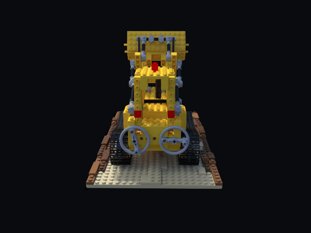
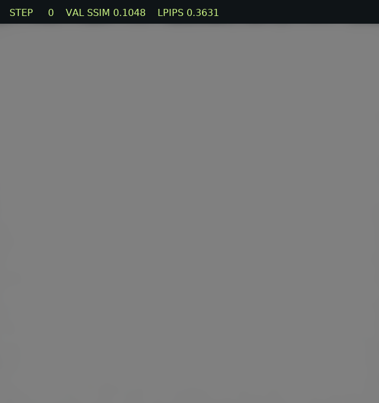
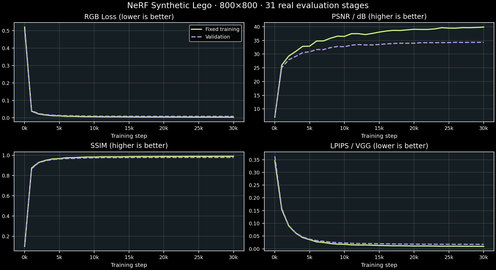

# 3DGS Studio

本地 3D Gaussian Splatting 训练工作台：目录导入、图片自动 COLMAP、GPU 训练、固定相机评测、实时渲染、训练动画和模型导出。

## 可视化展示

**多视角环绕预览**：完整高斯模型的 72 个实际渲染视角。网页中可播放、暂停、拖拽和缩放。



**训练阶段演变**：固定参考视角下，从 0 到 30000 步的 31 个真实模型快照。叠加指标为固定验证相机的均值；网页中可用 Step 下拉框保持同视角切换阶段。



**实际训练曲线**：原始 800×800 Lego，固定 8 个训练和 8 个验证视角。网页的 Loss、PSNR、SSIM、LPIPS 曲线均支持鼠标悬浮，查看对应 Step、指标和训练 / 验证值。



展示素材来自实际模型与评测数据，生成方式与来源见 [素材说明](docs/assets/SOURCE.md)。

## 快速启动

```bash
git clone https://github.com/lifeiXiao/3dgs-studio.git
cd 3dgs-studio
./start.sh
```

打开 <http://127.0.0.1:7860>。启动脚本自动使用项目 `.venv`，网页后台任务始终通过服务的 `sys.executable` 启动，不需要激活或选择虚拟环境。

## 默认参数与模型容量

网页首次进入和“恢复官方默认”使用 `studio/official.py` 中的统一配置。该配置逐字段对照 GraphDeco 官方 `arguments/__init__.py`，参考源码在 `third_party/gaussian-splatting`，提交号记录在 `STUDIO_SOURCE_COMMIT`。官方源码版权与许可保留于该目录。

| 设置 | 网页默认值 |
| --- | --- |
| 迭代数 | 30,000 |
| SH 阶数 | 3，即每个高斯 16 个 SH 系数 × RGB |
| 初始高斯 | NeRF 无稀疏点时 100,000；COLMAP 使用有效稀疏点 |
| 高斯数量上限 | 0＝不人为限制，跟随增密 / 裁剪 |
| 每步相机数 | 1 |
| 位置 LR 初始 / 最终 | 0.00016 / 0.0000016，再乘场景尺度 |
| 位置 LR 总步数 | 30,000 |
| SH DC LR / 高阶 LR | 0.0025 / 0.000125 |
| 不透明度 / 尺度 / 旋转 LR | 0.025 / 0.005 / 0.001 |
| Loss | 0.8 L1 + 0.2 (1 − SSIM) |
| 增密 | 500 到 15,000 步，每 100 步，梯度阈值 0.0002 |
| 不透明度重置间隔 | 3,000 步 |
| 背景 | 黑色，`white_background=False` |
| 评测模式 | `eval=False`，与官方 CLI 默认一致 |
| 图像分辨率 | `-r -1`，官方自动模式 |

3DGS 没有 MLP 网络宽度。这里的表示为每个高斯的位置、3 个对数尺度、wxyz 四元数、不透明度和 16×RGB 的 SH 颜色，共 59 个可训练标量。使用官方的 SH 参数化，没有 RGB sigmoid 饱和，也没有早期版本的固定 1024 / 16384 点限制。

工程架构与网页由 Studio 管理，CUDA 光栅化使用 **gsplat 1.5.3**。这不是直接运行官方 `train.py`：模型表示、优化默认值、SSIM、初始化、学习率计划和密度控制按官方配置对齐，渲染后端与日志/预览/评测实现不同，因此不承诺与 GraphDeco CUDA 渲染器逐像素、逐步或随机序列完全一致。官方 SSIM 和参考 SH 计算直接引用保留许可的源码。CPU 使用兼容参考后端，仅适合小场景，完整官方规模需要 CUDA。

gsplat 1.5.3 的不透明度重置条件存在运算优先级问题；Studio 显式执行官方 `min(opacity, 0.01)` 重置计划，并在更新前记录官方配置的固定评测。官方参数模式没有额外的前景 alpha loss、全局梯度裁剪或任意高斯上限。

## 原始分辨率

分辨率下拉框支持：

- **官方自动 `-r -1`**：宽度超过 1600 才自动缩小，Lego 800×800 保持不变。
- **原始尺寸 `-r 1`**：保留每张输入图像的实际宽高，无 512px 上限。
- `-r 2 / 4`：原图 1/2、1/4。
- 64 / 96 / 128 / 256 / 512 / 1024 / 1600：按指定像素宽度缩放并保持比例。

原图模式不会为了显存静默降采样。显存不足会在网页和日志中明确显示，需要降低分辨率或主动设置容量限制。

“下次训练设置”始终展示默认或用户编辑的下一次配置，不会因为载入旧实验就自动把旧参数覆盖到表单。实验实际参数保存在其 `config.json`，包括官方源码提交号和覆盖项。

## 数据与评测

- 上传文件夹，或选择项目内数据目录；已有项目数据不重复复制。
- 支持 `transforms.json`、`transforms_train.json` 的 OpenGL/Blender camera-to-world。
- 支持 COLMAP 去畸变后的 `PINHOLE` / `SIMPLE_PINHOLE` 文本模型；仅有照片时自动执行特征提取、匹配、稀疏重建与去畸变。
- 图像必须和相机内参的标定尺寸一致。
- 网页可选择全部匹配或顺序匹配，并显示 COLMAP 阶段、日志及注册情况。

**官方 `--eval` 默认关闭时，NeRF 的 train 与 test 图像合并训练。** 要保留独立 test 集，请在更多参数中勾选“评测模式”。`transforms_val.json` 的独立相机用于 Studio 的固定验证指标，不参与梯度优化；网页默认监测 8 个均匀选取的训练视角和 8 个验证视角。指标会标明视角数，这不是全测试集平均成绩。

Loss 面板可切换固定相机评测与随机训练 / EMA。随机视角、SH 阶数提升、增密和每 3000 步的不透明度重置都可能造成短期波动。应比较同一分辨率、同一组相机上的指标和渲染结果。

NeRF Synthetic Lego 可通过下列脚本下载 train / val / test 与准确位姿到 `data/datasets/lego`，来源和署名会写入该目录的 `SOURCE.md`：

```bash
.venv/bin/python scripts/download_lego.py
```

## 训练产物

每个 `data/runs/<id>` 包含：

- `config.json`、`status.json`、`training.log`：配置、持久状态和日志。
- `metrics.csv`：真实随机训练视角 Loss、EMA、PSNR、高斯数量、位置 LR 等。
- `evaluations.csv`、`evaluation.json`：固定相机的训练 / 验证指标与逐视角结果。
- `checkpoint.pt`、`best_checkpoint.pt`：最终与验证最优模型；包含 SH 阶数和颜色参数化，兼容历史模型读取。
- `gaussians.ply`：含完整 DC / 高阶 SH、不透明度、尺度、旋转的高斯模型。
- `initial.png`、`target.png`、`render.png`、`comparison.png`：实际初始、目标与训练渲染。
- `replay/`、`training.gif`：真实训练快照、时间轴回放和动画导出。

“三维场景”现在调用本机 CUDA **真实新视角 Gaussian 光栅化**：加载完整 checkpoint，使用全部高斯、各向异性尺度、旋转、不透明度、SH 颜色和深度遮挡；拖动旋转 / 滚轮缩放会重新渲染。默认对齐第一个训练相机，也可点击“对齐参考相机”。图像显示使用的模型快照步数，不把一个旧模型冒充当前迭代。

“几何检查”单独保留最多 8000 个抽样高斯中心和相机线框，仅用于空间布局检查，不代表最终外观。支持自动 Z-up / Y-up、手动切换和隐藏相机。三维渲染的相机与网格使用相同的坐标转换。

真实预览在独立只读模型上运行，不修改训练进程；缓存完整 checkpoint 并复用 CUDA 模型。交互时降低预览图像尺寸，停止拖动后自动细化；浏览器只保留一个在途请求。需要 CUDA 的真实预览与 CPU 几何检查清楚区分。

三维视图底部的 **Step 下拉框**列出该任务已保存的完整模型阶段。选择后暂停播放并保持当前相机、缩放与视场角，方便同视角对比；也可在选定阶段进行多视角环绕，或选择“最新模型”跟随训练。新生成的关键帧会自动加入选项，旧任务缺少历史模型时仅显示最新模型。

“三维场景”的播放按钮始终留在本视图。默认播放“训练演化 + 环绕”（有完整历史的任务）或“多视角环绕”（旧任务），自动绕物体一周并轻微改变俯仰角；可选 0.5× / 1× / 2×，播放中仍可拖动和缩放。时间轴在环绕模式控制角度，在演化模式选择真实训练步骤；暂停后恢复高清渲染。

新训练默认每约 1000 步记录完整三维模型至 `replay/models/*.pt`，含全部高斯与 SH 参数，不含优化器。长任务自动加大间隔，约保留 40 个常规关键帧（另含初始、首步和最终状态）；800px Lego 约占数 GB。空间不足 1GB 时暂停新增三维记录并保留已有关键帧及图像记录。加载历史模型期间会等待真实模型显示后再推进时间轴。旧任务没有完整历史时可直接播放多视角环绕；“训练渲染”和 GIF 导出仍是固定相机的真实训练图像序列。

## 存储与环境

默认将数据、训练结果、虚拟环境、CUDA 扩展缓存和评测权重保存在项目目录。首次使用 LPIPS 会自动下载 VGG16 与校准权重至 `.cache/torch`，以后直接复用。

可选的本机 `studio-local.json` 支持 `{"run_cache":"/path/to/training-cache"}`，将训练结果写入指定目录并通过 `data/runs/<id>` 链接访问。该配置不纳入 Git。

## SSIM 与 LPIPS 曲线

优化过程显示 Loss、PSNR、SSIM（越高越好）、LPIPS（越低越好）四组曲线，实线为固定训练相机，紫色虚线为固定验证相机。切换随机训练 / EMA 时，SSIM 和 LPIPS 仍使用固定相机评测。

这两项质量指标使用固定版本 GraphDeco 的 SSIM 和 LPIPS-VGG v0.1 模块，输入遵循其 [metrics.py](https://github.com/graphdeco-inria/gaussian-splatting/blob/54c035f7834b564019656c3e3fcc3646292f727d/metrics.py)：RGB `[0,1]`，评测前裁剪到合法范围，保持训练设置的分辨率。指标只用于评测，评测网络冻结参数。

新训练会在固定评测间隔自动记录 `train_ssim/train_lpips/val_ssim/val_lpips`。旧训练点击“补算历史指标”可从已保存的完整三维关键帧补算；缺少历史模型的步骤不会生成虚构数据。结果保存至 `quality_metrics.json`，训练结束后合并到 `evaluations.csv`。

## 实现与检查

- `studio/model.py`：各向异性 Gaussian、完整 SH、CUDA / CPU 光栅化适配。
- `studio/official.py`：统一官方默认值、参考源码信息、官方 SSIM 和密度策略。
- `studio/worker.py`：独立训练、LR 调度、密度调整、固定评测和快照。
- `studio/server.py`、`static/`：本地 API 与网页，默认监听 `127.0.0.1:7860`。
- `studio/runtime.py`：项目内 CUDA 编译缓存和兼容编译器选择；ABI 匹配时复用已编译模块。

```bash
.venv/bin/python -m pip install pytest
.venv/bin/python -m pytest -q
node --check static/app.js
.venv/bin/python -m pip check
```

测试涵盖官方源码默认值逐字段比较、网页初始默认值、SH3 模型容量、原始尺寸超过 512px、CUDA / 参考投影、颜色梯度、优化器状态在增密时的迁移、固定评测、CPU 回退、目录上传限制和动画导出。

三维播放回归检查：`node tests/test_scene_playback.cjs` 和 `node tests/test_viewer_camera.cjs`。可用 `.venv/bin/python scripts/verify_scene_playback.py <run_id> [--history]` 调用实际 GPU 接口，核验各视角图像不同、历史模型步数准确，并输出 GIF 与 JSON 报告。
